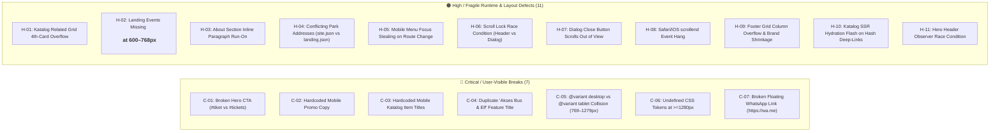
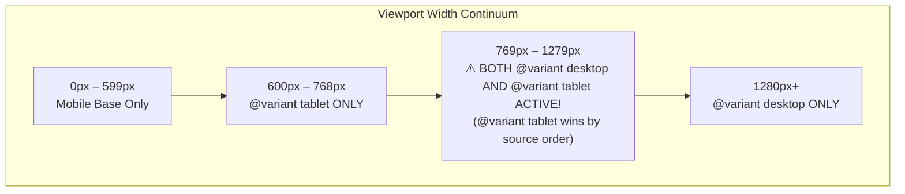

# Galaxy Waterpark Web — Comprehensive Frontend Deep-Scan Audit & Ultimate Fix Guide

> [!IMPORTANT]
> **Audit Scope & Methodology:** Every file across `frontend/src/app/`, `frontend/src/components/`, `frontend/src/styles/`, `frontend/src/services/`, `frontend/src/types/`, `frontend/src/fixtures/`, `frontend/public/`, and build configuration (`next.config.ts`, `package.json`, `tsconfig.json`) was inspected line-by-line at `main` (`14eb0f5`).
>
> This document catalogs **38 distinct defects, fragile patterns, blind spots, and edge cases** across 7 architectural domains, paired with **exact drop-in fixes** and **alternative architectural proposals**.

---

## 1. Executive Summary & Severity Matrix



| ID | Severity | Category | Summary | Location |
| :--- | :--- | :--- | :--- | :--- |
| **C-01** | 🔴 Critical | Functional / CTA | Hero primary button links to `#tiket`, but Tickets section is `id="tickets"` — clicking primary CTA does nothing | [landing.json](file:///D:/VSC/project-galaxyWaterparkWeb/frontend/src/fixtures/landing.json#L19), [tickets.tsx](file:///D:/VSC/project-galaxyWaterparkWeb/frontend/src/components/features/landing/sections/tickets/tickets.tsx#L23) |
| **C-02** | 🔴 Critical | Data Contract | `/promo` mobile cards hardcode `"Bonus voucher F&B"` in JSX for every promo item and strip copy via regex | [promo-grid.tsx](file:///D:/VSC/project-galaxyWaterparkWeb/frontend/src/components/features/promo/promo-grid.tsx#L20) |
| **C-03** | 🔴 Critical | Data Contract | `/katalog` mobile cards render `group.mobileItemName` (`"Slides"`) instead of `item.title`, making all 9 cards in a group identical on mobile | [katalog-page.tsx](file:///D:/VSC/project-galaxyWaterparkWeb/frontend/src/components/features/katalog/katalog-page.tsx#L24-L25) |
| **C-04** | 🔴 Critical | Content / Fixture | Location feature `"clock"` has copy-pasted desktop `"title": "Akses Bus & Elf"`, showing two identical headings on desktop | [landing.json](file:///D:/VSC/project-galaxyWaterparkWeb/frontend/src/fixtures/landing.json#L240-L252) |
| **C-05** | 🔴 Critical | CSS Architecture | `@variant desktop` (`>=769px`) and `@variant tablet` (`600px..1279px`) overlap at `769px–1279px`; `@variant tablet` is declared second and overrides desktop rules | [breakpoints.css](file:///D:/VSC/project-galaxyWaterparkWeb/frontend/src/styles/breakpoints.css#L1-L5), [tokens.css](file:///D:/VSC/project-galaxyWaterparkWeb/frontend/src/styles/tokens.css#L73-L108) |
| **C-06** | 🔴 Critical | CSS Tokens | `--landing-section-space`, `--type-section-tablet-size`, and `--type-section-tablet-leading` are only defined inside `@variant tablet` (`<1280px`) and become `undefined` at `>=1280px` | [tokens.css](file:///D:/VSC/project-galaxyWaterparkWeb/frontend/src/styles/tokens.css#L101-L108) |
| **C-07** | 🔴 Critical | Functional / Contact | Floating WhatsApp button points to bare `https://wa.me` with no phone number while `site.json` explicitly marks WhatsApp as unavailable (`href: null`) | [app-layout.tsx](file:///D:/VSC/project-galaxyWaterparkWeb/frontend/src/components/layout/app-layout.tsx#L37-L45), [site.json](file:///D:/VSC/project-galaxyWaterparkWeb/frontend/src/fixtures/site.json#L22-L27) |
| **H-01** | 🟠 High | Logic / Layout | Katalog detail `"Kategori Serupa"` filters `[0,1,2,3]` without `.slice(0, 3)`; viewing item index `>=4` renders 4 cards in a 3-column grid | [katalog-page.tsx](file:///D:/VSC/project-galaxyWaterparkWeb/frontend/src/components/features/katalog/katalog-page.tsx#L62) |
| **H-02** | 🟠 High | Responsive UI | Landing Events cards hide `<h3>` and `.description` below `769px` (`desktop:block`), leaving tablet cards (`600–768px`) without a title | [events.tsx](file:///D:/VSC/project-galaxyWaterparkWeb/frontend/src/components/features/landing/sections/events/events.tsx#L63-L69), [events.module.css](file:///D:/VSC/project-galaxyWaterparkWeb/frontend/src/components/features/landing/sections/events/events.module.css#L78-L135) |
| **H-03** | 🟠 High | Typography / CSS | Landing About sets `.copy p { display: inline; }` at `>=1280px`, merging separate `<p>` elements with zero space between sentences (`Yogyakarta.Mengusung`) | [about.module.css](file:///D:/VSC/project-galaxyWaterparkWeb/frontend/src/components/features/landing/sections/about/about.module.css#L109-L111), [about.tsx](file:///D:/VSC/project-galaxyWaterparkWeb/frontend/src/components/features/landing/sections/about/about.tsx#L53-L55) |
| **H-04** | 🟠 High | Content Consistency | Footer (`site.json`) and Visit section (`landing.json`) display two different physical street addresses for the waterpark | [site.json](file:///D:/VSC/project-galaxyWaterparkWeb/frontend/src/fixtures/site.json#L37), [landing.json](file:///D:/VSC/project-galaxyWaterparkWeb/frontend/src/fixtures/landing.json#L236) |
| **H-05** | 🟠 High | Accessibility / Focus | Closing mobile menu on route navigation unconditionally calls `trigger.focus()`, stealing focus back to the hamburger button instead of the new page | [app-header.tsx](file:///D:/VSC/project-galaxyWaterparkWeb/frontend/src/components/layout/app-header.tsx#L93-L101) |
| **H-06** | 🟠 High | State / DOM | Both `AppHeader` and `DetailDialog` mutate `document.body.style.overflow` independently; overlapping lifecycles can permanently lock page scroll | [app-header.tsx](file:///D:/VSC/project-galaxyWaterparkWeb/frontend/src/components/layout/app-header.tsx#L57-L58), [detail-dialog.tsx](file:///D:/VSC/project-galaxyWaterparkWeb/frontend/src/components/ui/detail-dialog.tsx#L24-L28) |
| **H-07** | 🟠 High | Modal UX | `DetailDialog` has `overflow: auto` while `.close` is `position: absolute; top: 10px; right: 10px;` — scrolling long modal content scrolls the close button off-screen | [detail-dialog.module.css](file:///D:/VSC/project-galaxyWaterparkWeb/frontend/src/components/ui/detail-dialog.module.css#L13-L29) |
| **H-08** | 🟠 High | Browser Compat | `useScrollCarousel` and `BackToTop` rely exclusively on the `scrollend` event without a timer fallback; infinite loop rebasing and focus transfer fail on older iOS Safari/WebViews | [use-scroll-carousel.ts](file:///D:/VSC/project-galaxyWaterparkWeb/frontend/src/components/ui/use-scroll-carousel.ts#L152), [back-to-top.tsx](file:///D:/VSC/project-galaxyWaterparkWeb/frontend/src/components/ui/back-to-top.tsx#L57) |
| **H-09** | 🟠 High | Footer Layout | `.contacts` (`width: 290px`) overflows its `268px` grid track (`grid-template-columns: minmax(0, 1fr) 268px`); `.brand h2` shrinks from `48px` on `/` to `24px` on `/promo` | [app-footer.module.css](file:///D:/VSC/project-galaxyWaterparkWeb/frontend/src/components/layout/app-footer.module.css#L161-L228) |
| **H-10** | 🟠 High | SSR / Hydration | `/katalog` uses URL hashes (`#family/family-1`) via `useHashView`; server always renders the full category overview first, causing a full-page flash on direct deep-links | [use-hash-view.ts](file:///D:/VSC/project-galaxyWaterparkWeb/frontend/src/components/ui/use-hash-view.ts#L10-L14), [katalog-page.tsx](file:///D:/VSC/project-galaxyWaterparkWeb/frontend/src/components/features/katalog/katalog-page.tsx#L39-L81) |
| **H-11** | 🟠 High | Lifecycle / Hook | `useHeroHeader` queries `document.getElementById("beranda")` synchronously inside `useSyncExternalStore` `subscribe`; if `<LandingPage>` streams or suspends, header transparency breaks | [use-hero-header.ts](file:///D:/VSC/project-galaxyWaterparkWeb/frontend/src/components/layout/use-hero-header.ts#L18-L42) |
| **M-01** | 🟡 Medium | Performance / Assets | `public/images/figma/gallery/` contains 4 uncompressed 3000–4000px PNGs totaling **17.8 MB** (`lazy-river.png` is 6.4 MB alone) | `frontend/public/images/figma/gallery/*` |
| **M-02** | 🟡 Medium | Service Layer | Katalog has no service (`catalog-service.ts`), no fixture (`catalog.json`), and generates 9 dummy items via `Array.from({ length: 9 })` in component code | [catalog-data.ts](file:///D:/VSC/project-galaxyWaterparkWeb/frontend/src/components/features/katalog/catalog-data.ts#L30-L36) |
| **M-03** | 🟡 Medium | Hardcoded Logic | Katalog mobile rail only activates when `category.id === "sports-wellness"`, silently breaking if backend category slugs change | [katalog-page.tsx](file:///D:/VSC/project-galaxyWaterparkWeb/frontend/src/components/features/katalog/katalog-page.tsx#L76) |
| **M-04** | 🟡 Medium | API Resilience | `apiClient` has no timeout (`AbortSignal.timeout`), does not parse Laravel `ApiErrorResponse` JSON bodies, and fails if `NEXT_PUBLIC_API_BASE_URL` has a trailing slash | [api-client.ts](file:///D:/VSC/project-galaxyWaterparkWeb/frontend/src/services/api-client.ts#L16-L31) |
| **M-05** | 🟡 Medium | Error Boundaries | Secondary pages (`PromoPage`, `EventPage`, `GaleriPage`) have no `try/catch` or `error.tsx` boundary, unlike `LandingPage` | [promo-page.tsx](file:///D:/VSC/project-galaxyWaterparkWeb/frontend/src/components/features/promo/promo-page.tsx#L4-L6), [event-page.tsx](file:///D:/VSC/project-galaxyWaterparkWeb/frontend/src/components/features/event/event-page.tsx#L4-L6), [galeri-page.tsx](file:///D:/VSC/project-galaxyWaterparkWeb/frontend/src/components/features/galeri/galeri-page.tsx#L4-L6) |
| **M-06** | 🟡 Medium | Touch Targets (WCAG) | `DetailDialog` close button (`36×36px`), `PagedCarousel` dots (`14×14px` in Tickets, `24×24px` default), and mobile Hero CTAs (`min-h-[25px]`) violate the 44×44px minimum touch target | [detail-dialog.module.css](file:///D:/VSC/project-galaxyWaterparkWeb/frontend/src/components/ui/detail-dialog.module.css#L32-L33), [tickets.module.css](file:///D:/VSC/project-galaxyWaterparkWeb/frontend/src/components/features/landing/sections/tickets/tickets.module.css#L134-L135), [hero.tsx](file:///D:/VSC/project-galaxyWaterparkWeb/frontend/src/components/features/landing/sections/hero/hero.tsx#L9) |
| **M-07** | 🟡 Medium | Image Optimization | `CategoryImage` uses `loading="eager"` and `sizes="(min-width: 769px) 100vw, 200vw"` on all 3 category cards, forcing oversized 2× downloads on mobile and competing with Hero LCP | [category-image.tsx](file:///D:/VSC/project-galaxyWaterparkWeb/frontend/src/components/features/landing/sections/categories/category-image.tsx#L17-L18) |
| **M-08** | 🟡 Medium | CSS Fragility | `CategoryArtwork` keys crop percentages by exact hardcoded file path (`"/images/figma/family-desktop.png"`); dynamic CMS URLs lose all custom framing | [category-artwork.ts](file:///D:/VSC/project-galaxyWaterparkWeb/frontend/src/components/features/landing/sections/categories/category-artwork.ts#L11-L27) |
| **M-09** | 🟡 Medium | Modal Backdrop | `DetailDialog` closes when `event.target === event.currentTarget`; if any consumer passes a `className` with `padding` on `<dialog>`, clicking inside the dialog padding closes the modal | [detail-dialog.tsx](file:///D:/VSC/project-galaxyWaterparkWeb/frontend/src/components/ui/detail-dialog.tsx#L36) |
| **M-10** | 🟡 Medium | Breakpoint Fallback | `AppHeader` reads `--navigation-breakpoint` from `getComputedStyle` without a fallback (`|| "1024px"`), producing an invalid `(min-width: )` media query if styles haven't loaded | [app-header.tsx](file:///D:/VSC/project-galaxyWaterparkWeb/frontend/src/components/layout/app-header.tsx#L53-L56) |
| **L-01** | 🟢 Low | Dead Code / Deps | `clsx` and `tailwind-merge` are installed in `package.json`, but `src/lib/utils.ts` uses a naive `.filter(Boolean).join(" ")` and `cn()` is never imported anywhere | [package.json](file:///D:/VSC/project-galaxyWaterparkWeb/frontend/package.json#L12-L20), [utils.ts](file:///D:/VSC/project-galaxyWaterparkWeb/frontend/src/lib/utils.ts#L1-L3) |
| **L-02** | 🟢 Low | Dead Code | `WireframeText` component (`wireframe-text.tsx` & `wireframe-text.module.css`) is unused across the entire codebase | [wireframe-text.tsx](file:///D:/VSC/project-galaxyWaterparkWeb/frontend/src/components/ui/wireframe-text.tsx#L1-L26) |
| **L-03** | 🟢 Low | Barrel Exports | `src/services/index.ts` and `src/types/index.ts` omit most services and types (`promo-service`, `event-service`, `gallery-service`, `site-service`, `landing.ts`, `public-pages.ts`, `site.ts`) | [services/index.ts](file:///D:/VSC/project-galaxyWaterparkWeb/frontend/src/services/index.ts#L1-L2), [types/index.ts](file:///D:/VSC/project-galaxyWaterparkWeb/frontend/src/types/index.ts#L1) |
| **L-04** | 🟢 Low | Font Loading | `InterVariable.woff2` is loaded twice: once in `src/app/layout.tsx` (`--font-sans`) and again in `src/components/features/landing/lib/landing-font.ts` | [layout.tsx](file:///D:/VSC/project-galaxyWaterparkWeb/frontend/src/app/layout.tsx#L8-L13), [landing-font.ts](file:///D:/VSC/project-galaxyWaterparkWeb/frontend/src/components/features/landing/lib/landing-font.ts#L3-L7) |
| **L-05** | 🟢 Low | SEO / Metadata | Secondary route pages (`/promo`, `/event`, `/katalog`, `/galeri`) lack `description`, `openGraph`, and `alternates.canonical` metadata | [promo/page.tsx](file:///D:/VSC/project-galaxyWaterparkWeb/frontend/src/app/promo/page.tsx#L4-L6), [event/page.tsx](file:///D:/VSC/project-galaxyWaterparkWeb/frontend/src/app/event/page.tsx#L4-L6), [katalog/page.tsx](file:///D:/VSC/project-galaxyWaterparkWeb/frontend/src/app/katalog/page.tsx#L4-L6), [galeri/page.tsx](file:///D:/VSC/project-galaxyWaterparkWeb/frontend/src/app/galeri/page.tsx#L4-L6) |

---

## 2. Critical Functional, Data Contract & Content Defects

### C-01: Broken Hero Primary CTA (`#tiket` vs `id="tickets"`)
> [!CAUTION]
> Clicking the primary call-to-action button **"Lihat Harga Tiket"** on the Landing Hero does nothing because the target anchor ID does not exist in the DOM.

- **Evidence:**
  - In [landing.json](file:///D:/VSC/project-galaxyWaterparkWeb/frontend/src/fixtures/landing.json#L19):
    ```json
    "cta_label": "Lihat Harga Tiket",
    "cta_href": "#tiket",
    ```
  - In [tickets.tsx](file:///D:/VSC/project-galaxyWaterparkWeb/frontend/src/components/features/landing/sections/tickets/tickets.tsx#L22-L26):
    ```tsx
    <section
      id="tickets"
      className={`${styles.section} ${landingFont.className}`}
      aria-labelledby="tickets-heading"
    >
    ```
  - Furthermore, neither `#tickets` nor `#katalog` has `scroll-margin-top: var(--header-height, 64px)` applied, so jumping to an anchor hides the top of the section underneath the sticky `64px` header.

---

### C-02: Hardcoded Mobile Copy & Fragile Regex in `/promo` (`PromoGrid`)
> [!CAUTION]
> On viewports `< 600px`, every single promotion card on `/promo` ignores `item.benefit` and displays the hardcoded string `"Bonus voucher F&B"`, even when the card is "Gratis Tiket Masuk" or "Diskon Rombongan 25%".

- **Evidence:**
  - In [promo-grid.tsx](file:///D:/VSC/project-galaxyWaterparkWeb/frontend/src/components/features/promo/promo-grid.tsx#L20):
    ```tsx
    <div className={styles.body}>
      <h2>
        <span className={styles.desktopCopy}>{item.benefit}</span>
        <span className={styles.mobileCopy}>Bonus voucher F&B</span>
      </h2>
      <p>
        <span className={styles.desktopCopy}>{item.benefit_description}</span>
        <span className={styles.mobileCopy}>
          {item.benefit_description.replace(/ dengan harga spesial$/, "")}
        </span>
      </p>
    </div>
    ```
- **Why This Breaks:**
  1. In `promo.json`, items have distinct benefits (`"Bonus Voucher F&B"`, `"Gratis Tiket Masuk"`, `"Diskon Rombongan 25%"`), yet mobile users see `"Bonus voucher F&B"` on all cards.
  2. Performing `.replace(/ dengan harga spesial$/, "")` in the view layer couples JSX rendering to a specific Indonesian phrase from one fixture item.

---

### C-03: Hardcoded Mobile Item Name & Fragile Excerpt Regex in `/katalog` (`KatalogPage`)
> [!CAUTION]
> On `/katalog`, every card inside a category renders `group.mobileItemName` on mobile instead of `item.title`, and strips ellipsis via regex to append hardcoded bold text.

- **Evidence:**
  - In [katalog-page.tsx](file:///D:/VSC/project-galaxyWaterparkWeb/frontend/src/components/features/katalog/katalog-page.tsx#L21-L30):
    ```tsx
    function Card({ group, index, compact = false }: { group: CatalogGroup; index: number; compact?: boolean }) {
      const item = catalogItems(group)[index];
      const Heading = compact ? "h3" : "h2";
      return <a className={`${styles.card} ${compact ? styles.compactCard : ""}`} href={`#${group.id}/${item.id}`}>
        <Artwork group={group} image={item.image} alt={item.title} />
        <div className={styles.cardBody}>
          <Heading>
            <span className={styles.desktopText}>{item.title}</span>
            <span className={styles.mobileText}>{group.mobileItemName}</span>
          </Heading>
          <p className={styles.desktopCopy}>{group.description}</p>
          <p className={styles.mobileCopy}>
            {group.excerpt.replace(/\.{3}$/, "")} <strong>...selengkapnya</strong>
          </p>
        </div>
      </a>;
    }
    ```
  - And in [katalog-page.tsx](file:///D:/VSC/project-galaxyWaterparkWeb/frontend/src/components/features/katalog/katalog-page.tsx#L55):
    ```tsx
    <h1 ref={heading} tabIndex={-1}>
      <span className={styles.desktopText}>{item.title}</span>
      <span className={styles.mobileText}>{group.mobileItemName}</span>
    </h1>
    ```
- **Why This Breaks:**
  1. When a mobile user expands a category (`#family`) or views `"Kategori Serupa"`, all 9 cards (`Perosotan 1` through `Perosotan 9`) display the identical title `"Slides"` (or `"Olympic"`, `"Gazebo"`).
  2. When viewing the detail page (`#family/family-3`) on mobile, the `<h1>` heading says `"Slides"` regardless of which item was clicked.

---

### C-04: Copy-Paste Defect in `landing.json` (`"Akses Bus & Elf"` Duplicated)
- **Evidence:**
  - In [landing.json](file:///D:/VSC/project-galaxyWaterparkWeb/frontend/src/fixtures/landing.json#L239-L253):
    ```json
    {
      "id": "bus",
      "icon": "bus",
      "title": "Akses Bus & Elf",
      "description": "Jalan lebar, mudah untuk rombongan."
    },
    {
      "id": "clock",
      "icon": "clock",
      "title": "Akses Bus & Elf",
      "mobile_title": "30 menit dari kota",
      "description": "Sekitar 25-30 menit dari pusat Kota Jogja.",
      "mobile_description": "Akses cepat dari pusat Kota Jogja."
    }
    ```
- **Impact:** On all viewports `>= 769px` (`desktop:inline` in [visit.tsx](file:///D:/VSC/project-galaxyWaterparkWeb/frontend/src/components/features/landing/sections/visit/visit.tsx#L50)), the Visit section displays **two cards both titled `"Akses Bus & Elf"`** side-by-side. The second card (`id: "clock"`) should have `"title": "30 Menit dari Kota"`.

---

### C-07: Broken Floating WhatsApp Action & Data Contract Discrepancy
- **Evidence:**
  - In [site.json](file:///D:/VSC/project-galaxyWaterparkWeb/frontend/src/fixtures/site.json#L22-L27):
    ```json
    {
      "id": "whatsapp",
      "label": "Nomor WhatsApp belum tersedia",
      "href": null,
      "icon": "whatsapp"
    }
    ```
  - Yet in [app-layout.tsx](file:///D:/VSC/project-galaxyWaterparkWeb/frontend/src/components/layout/app-layout.tsx#L37-L45):
    ```tsx
    <a
      className={styles.whatsapp}
      href="https://wa.me"
      target="_blank"
      rel="noreferrer"
      aria-label="Chat"
    >
      <AppIcon name="whatsapp" size={32} />
    </a>
    ```
- **Why This Breaks:**
  1. `https://wa.me` without a phone number redirects the user to WhatsApp's generic homepage or error screen instead of opening a chat with Galaxy Waterpark.
  2. `AppLayout` ignores `site.contacts` from `getSiteChrome()` and hardcodes `href="https://wa.me"` and an English `aria-label="Chat"` on an Indonesian site.

---

## 3. CSS Architecture, Breakpoint Collisions & Token Defects

### C-05: `@variant desktop` vs `@variant tablet` Cascade Collision (`769px` to `1279px`)
> [!WARNING]
> This is the most pervasive structural flaw in the frontend stylesheet architecture. Between `769px` and `1279px`, **both** `@variant desktop` and `@variant tablet` match simultaneously.

- **Evidence:**
  - In [breakpoints.css](file:///D:/VSC/project-galaxyWaterparkWeb/frontend/src/styles/breakpoints.css#L1-L5):
    ```css
    @custom-variant desktop (@media (min-width: 769px));
    @custom-variant navigation (@media (min-width: 1024px));
    @custom-variant tablet (@media (min-width: 600px) and (width < 1280px));
    @custom-variant motion-desktop (@media (min-width: 1280px) and (hover: hover) and (pointer: fine));
    ```



- **Concrete Consequences Across the Codebase:**
  1. **`tokens.css` ([lines 73–108](file:///D:/VSC/project-galaxyWaterparkWeb/frontend/src/styles/tokens.css#L73-L108))**:
     - `@variant desktop` sets `--landing-gutter: clamp(40px, 5.555556vw, 80px);`.
     - Immediately below, `@variant tablet` overrides `--landing-gutter: clamp(32px, 4vw, 48px);` for all viewports up to `1279px`.
  2. **Dead CSS Rules in `reviews.module.css` ([lines 130–140](file:///D:/VSC/project-galaxyWaterparkWeb/frontend/src/components/features/landing/sections/reviews/reviews.module.css#L130-L140))**:
     - `@variant desktop { @media (max-width: 1100px) { .slide { width: calc((100% - 24px) / 2); } } }` is 100% dead code because `@variant tablet` (`600px <= width < 1280px`) on lines 142–199 comes later in the file and overwrites `.slide`, `.card`, `.rating`, `.quote`, `.author`, and `.action` for all widths up to `1279px`.
  3. **Tailwind Utility Order vs Component Intention**:
     - In [section-heading.tsx](file:///D:/VSC/project-galaxyWaterparkWeb/frontend/src/components/features/landing/components/section-heading.tsx#L5-L6), `desktop:text-(length:--type-section-desktop-size)` is overridden by `tablet:text-(length:--type-section-tablet-size)` from `769px` to `1279px`.
     - Conversely, whenever a component only writes `desktop:block` or `desktop:hidden` without `tablet:*` (such as [events.tsx](file:///D:/VSC/project-galaxyWaterparkWeb/frontend/src/components/features/landing/sections/events/events.tsx#L63-L69), [visit.tsx](file:///D:/VSC/project-galaxyWaterparkWeb/frontend/src/components/features/landing/sections/visit/visit.tsx#L47-L58), [hero.tsx](file:///D:/VSC/project-galaxyWaterparkWeb/frontend/src/components/features/landing/sections/hero/hero.tsx#L46-L47), [opening-hours.tsx](file:///D:/VSC/project-galaxyWaterparkWeb/frontend/src/components/features/landing/sections/opening-hours/opening-hours.tsx#L24-L40), [tickets.tsx](file:///D:/VSC/project-galaxyWaterparkWeb/frontend/src/components/features/landing/sections/tickets/tickets.tsx#L35-L36)), the DOM switches at **`769px`**, while the CSS Module styles switch at **`600px`** (`@variant tablet`) and **`1280px`** (when `@variant tablet` stops matching)!

---

### C-06: Undefined CSS Custom Properties Outside `@variant tablet` (`>= 1280px` & `< 600px`)
- **Evidence:**
  - In [tokens.css](file:///D:/VSC/project-galaxyWaterparkWeb/frontend/src/styles/tokens.css#L101-L108):
    ```css
    @variant tablet {
      :root {
        --landing-gutter: clamp(32px, 4vw, 48px);
        --landing-section-space: 64px;
        --type-section-tablet-size: 28px;
        --type-section-tablet-leading: 36px;
      }
    }
    ```
- **Why This Is Dangerous:**
  - `--landing-section-space`, `--type-section-tablet-size`, and `--type-section-tablet-leading` are **never defined in base `:root`**.
  - At `< 600px` and `>= 1280px`, those three variables evaluate to **guaranteed-invalid (`unset`)**! If any component references `var(--landing-section-space)` outside `@variant tablet` without a fallback value, the entire CSS declaration silently fails at `>= 1280px`.

---

### H-02: Landing Events Missing `<h3>` Title at `600px–768px` (Tablet Breakpoint Mismatch)
- **Evidence:**
  - In [events.tsx](file:///D:/VSC/project-galaxyWaterparkWeb/frontend/src/components/features/landing/sections/events/events.tsx#L62-L70):
    ```tsx
    <div className={styles.body}>
      <h3 className="hidden font-bold desktop:block">{item.title}</h3>
      <p className={`${styles.excerpt} desktop:hidden`}>
        {item.excerpt}
      </p>
      <p className={`${styles.description} hidden desktop:block`}>
        {item.description}
      </p>
    </div>
    ```
  - Meanwhile, in [events.module.css](file:///D:/VSC/project-galaxyWaterparkWeb/frontend/src/components/features/landing/sections/events/events.module.css#L78-L135), `@variant tablet` (`600px–1279px`) switches `.track` to a grid and styles `.card` as a horizontal card with `.body h3` and `.description`.
- **Impact:** At `600px–768px`, `@variant tablet` is active, so the card expands into the tablet layout with a right-side text column, **but `<h3>` and `.description` remain `display: none`** because `desktop:block` only activates at `769px`!

---

### H-03: Landing About Section Inline Paragraph Run-On at `>= 1280px`
- **Evidence:**
  - In [about.tsx](file:///D:/VSC/project-galaxyWaterparkWeb/frontend/src/components/features/landing/sections/about/about.tsx#L53-L55):
    ```tsx
    {content.paragraphs.map((paragraph, index) => (
      <Paragraph key={index} {...paragraph} />
    ))}
    ```
  - In [about.module.css](file:///D:/VSC/project-galaxyWaterparkWeb/frontend/src/components/features/landing/sections/about/about.module.css#L109-L111):
    ```css
    @variant desktop {
      /* ... */
      .copy p {
        display: inline;
      }
    }
    ```
- **Impact:** At `>= 1280px` (where `@variant tablet`'s `.copy p { display: block; }` stops overriding `@variant desktop`), both `<p>` tags become `display: inline` with no space character between `</p><p>`. The first paragraph ends with `Bantul, Yogyakarta.` and immediately collides into the second paragraph `Mengusung konsep` as `Bantul, Yogyakarta.Mengusung konsep`!

---

### H-09: Footer Grid Track Overflow & Inconsistent Brand Sizing
- **Evidence:**
  - In [app-footer.module.css](file:///D:/VSC/project-galaxyWaterparkWeb/frontend/src/components/layout/app-footer.module.css#L159-L172):
    ```css
    @variant desktop {
      .inner {
        grid-template-columns: minmax(0, 1fr) 268px;
        /* ... */
      }
      .contacts {
        width: 290px;
        justify-self: end;
      }
    }
    ```
    `.contacts` is `290px` wide inside a `268px` grid track, causing a `22px` horizontal overflow to the left of its track boundary.
  - Furthermore, in [app-footer.module.css](file:///D:/VSC/project-galaxyWaterparkWeb/frontend/src/components/layout/app-footer.module.css#L214-L228):
    ```css
    :global(body:has([data-page="content"])) .brand h2 {
      font-size: var(--type-section-size); /* 20px */
      line-height: var(--type-section-leading);
    }
    @media (min-width: 600px) {
      :global(body:has([data-page="content"])) .brand h2 {
        font-size: var(--type-action-size); /* 24px */
        line-height: var(--type-action-leading);
      }
    }
    ```
    Why does the global footer's `Galaxy Waterpark` brand title shrink from `48px` on `/` to `24px` on `/promo`, `/event`, `/katalog`, and `/galeri`? In [app-layout.tsx](file:///D:/VSC/project-galaxyWaterparkWeb/frontend/src/components/layout/app-layout.tsx#L19), `data-page="content"` is actually never set on any element (`data-content-page` is used instead), making lines 214–236 dead selector rules trying to target a non-existent `[data-page="content"]` attribute!

---

## 4. Secondary Pages & Katalog Logic Defects

### H-01: Katalog Detail `"Kategori Serupa"` Renders 4 Cards in a 3-Column Grid
- **Evidence:**
  - In [katalog-page.tsx](file:///D:/VSC/project-galaxyWaterparkWeb/frontend/src/components/features/katalog/katalog-page.tsx#L62):
    ```tsx
    <div className={styles.relatedGrid}>
      {[0, 1, 2, 3]
        .filter((index) => catalogItems(group)[index].id !== item.id)
        .map((index) => (
          <Card key={index} group={group} index={index} compact />
        ))}
    </div>
    ```
- **Why This Breaks:**
  - `catalogItems(group)` returns 9 items (`index` `0` through `8`).
  - If the user clicks on item `0`, `1`, `2`, or `3`, `.filter(...)` removes 1 item from `[0, 1, 2, 3]`, leaving **3** cards.
  - If the user expands the category (`#family`) and clicks on item `4`, `5`, `6`, `7`, or `8` (e.g., `#family/family-5`), `catalogItems(group)[index].id !== item.id` is `true` for all four indices `[0, 1, 2, 3]`.
  - Result: **4 cards** are rendered inside `.relatedGrid` (`grid-template-columns: repeat(3, minmax(0, 1fr))`), leaving a dangling 4th card on a second row!

---

### H-10: Katalog Hash Routing SSR / Hydration Flash & Scroll Jump (`useHashView`)
- **Evidence:**
  - In [use-hash-view.ts](file:///D:/VSC/project-galaxyWaterparkWeb/frontend/src/components/ui/use-hash-view.ts#L10-L15):
    ```ts
    const getServerSnapshot = () => "";

    export function useHashView() {
      return useSyncExternalStore(subscribe, getSnapshot, getServerSnapshot);
    }
    ```
  - And in [katalog-page.tsx](file:///D:/VSC/project-galaxyWaterparkWeb/frontend/src/components/features/katalog/katalog-page.tsx#L69):
    ```tsx
    <a className={styles.back} href="#" aria-label="Kembali ke semua kategori">
    ```
- **Why This Breaks:**
  1. **SSR Flash (FOUC)**: Because the URL hash (`#family/family-1`) is never sent to the server in HTTP requests, `getServerSnapshot` returns `""`. When a user refreshes or shares a deep link to `/katalog#family/family-1`, the server HTML renders the **3-category overview page**, and after JS hydration completes on the client, React unmounts the overview and mounts the detail view.
  2. **`href="#"` Native Scroll Jump**: Clicking `<a href="#">` triggers the browser's native jump-to-top and leaves a trailing `#` in the address bar.
  3. **No SEO Indexability**: Search engines cannot index individual wahana/facility categories or detail pages because they are all hidden behind client-only `#hash` fragments on a single URL (`/katalog`).

---

### M-02 & M-03: Katalog Data Hardcoded in Component Layer & Slug-Coupled Mobile Rail
- **Evidence:**
  - [catalog-data.ts](file:///D:/VSC/project-galaxyWaterparkWeb/frontend/src/components/features/katalog/catalog-data.ts#L30-L36) synthesizes 9 fake items per category (`Perosotan 1`..`Perosotan 9`) using `Array.from({ length: 9 })` instead of reading from `src/fixtures/catalog.json` via a `src/services/catalog-service.ts`.
  - In [katalog-page.tsx](file:///D:/VSC/project-galaxyWaterparkWeb/frontend/src/components/features/katalog/katalog-page.tsx#L76):
    ```tsx
    <div
      className={`${styles.preview} ${category.id === "sports-wellness" ? styles.mobileRail : ""}`}
      tabIndex={category.id === "sports-wellness" ? 0 : undefined}
      aria-label={category.mobileTitle}
    >
    ```
    Only `"sports-wellness"` gets horizontal scrolling on mobile (`.mobileRail`), while `"family"` and `"facilities"` hide items 2 and 3 via `.preview > :nth-child(n + 2) { display: none; }` ([katalog.module.css](file:///D:/VSC/project-galaxyWaterparkWeb/frontend/src/components/features/katalog/katalog.module.css#L73-L75))! And yet on line 78, `"family"` and `"facilities"` still render `<a className={styles.endAction}>Lihat selengkapnya</a>` inside `.preview`, which gets hidden by `:nth-child(n + 2)` on non-rail categories!

---

## 5. Accessibility (a11y), Focus, Modal & Lifecycle Bugs

### H-05: Mobile Menu Focus Stealing on Every Route Navigation (`AppHeader`)
> [!WARNING]
> Navigating to a new page from the mobile drawer steals keyboard/screen-reader focus back to the hamburger menu button instead of letting focus move to the new route.

- **Evidence:**
  - In [app-header.tsx](file:///D:/VSC/project-galaxyWaterparkWeb/frontend/src/components/layout/app-header.tsx#L93-L101):
    ```tsx
    return () => {
      document.body.style.overflow = previousOverflow;
      window.removeEventListener("keydown", onKeyDown);
      mediaQuery.removeEventListener("change", onBreakpointChange);
      if (trigger && trigger.getClientRects().length > 0) {
        trigger.focus();
      }
    };
    ```
- **Why This Happens:**
  - When the user clicks a `<Link>` inside the mobile navigation drawer, `onClick={closeMenu}` sets `isOpen = false`.
  - The `useEffect` cleanup runs immediately while the mobile hamburger button (`trigger`) is still visible (`getClientRects().length > 0`).
  - `trigger.focus()` yanks focus back to the hamburger button on every mobile navigation! Focus should only return to `trigger` when the menu is dismissed via `Escape`, the close button, or the backdrop — **not** when navigating to a new route.

---

### H-06: `document.body.style.overflow` Scroll-Lock Race Condition
- **Evidence:**
  - Both [app-header.tsx](file:///D:/VSC/project-galaxyWaterparkWeb/frontend/src/components/layout/app-header.tsx#L57-L58) and [detail-dialog.tsx](file:///D:/VSC/project-galaxyWaterparkWeb/frontend/src/components/ui/detail-dialog.tsx#L24-L28) capture `const previous = document.body.style.overflow;` and set `document.body.style.overflow = "hidden";`.
- **Why This Breaks:**
  - If a user has a `DetailDialog` open (`body.style.overflow === "hidden"`) and opens the mobile header menu (which is `z-index: 50` sticky header), `AppHeader` captures `previousOverflow = "hidden"`. If `DetailDialog` closes first (restoring `overflow = "hidden"`) and then `AppHeader` closes (restoring `previousOverflow = "hidden"`), `document.body.style.overflow` remains stuck at `"hidden"` permanently until a hard page reload!
  - Better approach: Use pure CSS on `body`:
    ```css
    body:has(dialog[open], [data-mobile-menu-open="true"]) {
      overflow: hidden;
    }
    ```
    Zero JS state, zero race conditions, automatic cleanup on unmount.

---

### H-07 & M-09: `DetailDialog` Scrolling Close Button & Fragile Backdrop Click
- **Evidence:**
  - In [detail-dialog.module.css](file:///D:/VSC/project-galaxyWaterparkWeb/frontend/src/components/ui/detail-dialog.module.css#L13-L29):
    ```css
    .dialog {
      /* ... */
      max-height: calc(100dvh - 32px);
      overflow: auto;
    }
    .close {
      position: absolute;
      top: 10px;
      right: 10px;
      z-index: 2;
      /* ... */
      width: 36px;
      height: 36px;
    }
    ```
  - In [detail-dialog.tsx](file:///D:/VSC/project-galaxyWaterparkWeb/frontend/src/components/ui/detail-dialog.tsx#L36):
    ```tsx
    onClick={(event) => {
      if (event.target === event.currentTarget) dialog.current?.close();
    }}
    ```
- **Why This Breaks:**
  1. Because `.dialog` is the scroll container (`overflow: auto`), `position: absolute` positions `.close` relative to the scrollable content box. When a user scrolls down inside a Promo or Event detail modal on a small phone screen, the `×` close button scrolls out of view!
  2. `.close` is `36px × 36px` (below the 44×44px WCAG 2.5.5 touch target size).
  3. Clicking inside any padding applied to `<dialog>` via `className` triggers `event.target === event.currentTarget` and unexpectedly closes the dialog.

---

### H-08: Missing Fallback for `scrollend` Event (`useScrollCarousel` & `BackToTop`)
- **Evidence:**
  - In [use-scroll-carousel.ts](file:///D:/VSC/project-galaxyWaterparkWeb/frontend/src/components/ui/use-scroll-carousel.ts#L152):
    ```ts
    element.addEventListener("scrollend", settle, { passive: true });
    ```
  - In [back-to-top.tsx](file:///D:/VSC/project-galaxyWaterparkWeb/frontend/src/components/ui/back-to-top.tsx#L57):
    ```ts
    window.addEventListener("scrollend", onScrollEnd, { once: true });
    ```
- **Why This Breaks:**
  - On older iOS Safari (< 17.4) and embedded Android/iOS in-app WebViews (Instagram, TikTok, WhatsApp browsers — prime traffic sources for a waterpark!), `scrollend` is either unsupported or unreliable during momentum touch scrolling.
  - Without a debounced `scroll` timer fallback (`setTimeout(..., 150)` when `!("onscrollend" in window)`), infinite-loop carousels (`useScrollCarousel` with `loop: true`) never call `settle()` to rebase their scroll position, hitting the end of the cloned track and stopping dead!

---

### H-11: `useHeroHeader` Synchronous `#beranda` Lookup Fragility
- **Evidence:**
  - In [use-hero-header.ts](file:///D:/VSC/project-galaxyWaterparkWeb/frontend/src/components/layout/use-hero-header.ts#L18-L21):
    ```ts
    const subscribe = useCallback(
      (onStoreChange: () => void) => {
        const hero = pathname === "/" ? document.getElementById("beranda") : null;
        if (!header || !hero) return () => {};
    ```
- **Why This Is Fragile:**
  - `AppHeader` is mounted in `AppLayout` above `{children}`. If `LandingPage` ever suspends (e.g., when `getLandingContent()` switches from synchronous fixture clone to an async `await apiClient.get("/landing")` over the network with a `loading.tsx` boundary!), `document.getElementById("beranda")` returns `null` when `AppHeader` mounts.
  - Because `subscribe` only depends on `[header, pathname]`, when `<LandingPage>` finishes streaming and `#beranda` enters the DOM, `subscribe` is **never re-invoked**, leaving the header permanently stuck in non-hero solid mode on the home page!

---

## 6. Performance, Asset & Service Layer Blind Spots

### M-01: 17.8 MB of Uncompressed High-Resolution PNGs in `public/images/figma/gallery/`
- **Evidence:**
  - `public/images/figma/gallery/lazy-river.png`: **6,421 KB (6.4 MB)** (`4000 × 3000`)
  - `public/images/figma/gallery/children-pool.png`: **4,728 KB (4.7 MB)** (`4000 × 3000`)
  - `public/images/figma/gallery/family.png`: **3,701 KB (3.7 MB)** (`3024 × 3024`)
  - `public/images/figma/gallery/water-arch.png`: **3,005 KB (3.0 MB)** (`3024 × 3024`)
- **Impact:**
  1. Bloats git repository size and deployment artifact size by ~18 MB for just 4 photos.
  2. Causes high CPU/memory spikes on the Next.js server (`sharp`) during cold-start image optimization on first request.
  3. If `unoptimized` fallback is ever triggered, mobile users download 18 MB of raw PNGs.

---

### M-04 & M-05: `apiClient` Edge Cases & Missing Error Boundaries on Secondary Pages
- **Evidence:**
  - In [api-client.ts](file:///D:/VSC/project-galaxyWaterparkWeb/frontend/src/services/api-client.ts#L7-L31):
    ```ts
    function buildUrl(path: string): string {
      const normalizedPath = path.startsWith("/") ? path : `/${path}`;
      return `${API_BASE_URL}${normalizedPath}`;
    }
    ```
    1. If `NEXT_PUBLIC_API_BASE_URL` is configured with a trailing slash (e.g. `https://api.example.com/api/v1/`), `buildUrl("/promos")` produces `https://api.example.com/api/v1//promos` (double slash).
    2. No `AbortSignal.timeout(10_000)` is configured — a hung backend connection hangs Next.js SSR indefinitely.
    3. When `!response.ok`, it throws a generic string `API request failed: ${response.status}` without attempting to parse Laravel's structured `ApiErrorResponse` (`{ error: { code, message, details } }`) defined in [api.ts](file:///D:/VSC/project-galaxyWaterparkWeb/frontend/src/types/api.ts#L6-L12).
  - In [promo-page.tsx](file:///D:/VSC/project-galaxyWaterparkWeb/frontend/src/components/features/promo/promo-page.tsx#L4-L6), [event-page.tsx](file:///D:/VSC/project-galaxyWaterparkWeb/frontend/src/components/features/event/event-page.tsx#L4-L6), and [galeri-page.tsx](file:///D:/VSC/project-galaxyWaterparkWeb/frontend/src/components/features/galeri/galeri-page.tsx#L4-L6):
    - Unlike [landing-page.tsx](file:///D:/VSC/project-galaxyWaterparkWeb/frontend/src/components/features/landing/landing-page.tsx#L8-L26) which wraps `await getLandingContent()` in a `try/catch` and renders a graceful fallback UI, secondary pages call `await getPromotions()`, `await getEvents()`, and `await getGalleryPhotos()` with **no `try/catch`** and **no `src/app/error.tsx`**. When the real backend API is connected, any network failure crashes the entire route with an unhandled 500 error.

---

### M-07 & M-08: `Categories` Oversized Image Downloads & Path-Coupled Crop Coordinates
- **Evidence:**
  - In [category-image.tsx](file:///D:/VSC/project-galaxyWaterparkWeb/frontend/src/components/features/landing/sections/categories/category-image.tsx#L17-L18):
    ```tsx
    loading="eager"
    sizes="(min-width: 769px) 100vw, 200vw"
    ```
    - On desktop, each category card occupies `33vw` (1 of 3 columns), not `100vw`. On mobile, `200vw` forces Next.js to serve an image 2× wider than the screen for all 3 below-the-fold cards with `loading="eager"`, directly competing for bandwidth with the above-the-fold `HeroImage` LCP!
    - Also in [categories.tsx](file:///D:/VSC/project-galaxyWaterparkWeb/frontend/src/components/features/landing/sections/categories/categories.tsx#L32-L40), `<picture>` wraps `<source media="(max-width: 768px)" srcSet={category.mobile_image_url} />` around Next.js `<Image fill />` (`CategoryImage`). Because Next.js `<Image>` generates its own `srcSet` on the inner ``, wrapping it in a manual `<picture>` with an unoptimized raw path in `<source srcSet={category.mobile_image_url}>` bypasses Next.js WebP/AVIF optimization on mobile!
  - In [category-artwork.ts](file:///D:/VSC/project-galaxyWaterparkWeb/frontend/src/components/features/landing/sections/categories/category-artwork.ts#L11-L27):
    - Crop coordinates are keyed by `"/images/figma/family-desktop.png"`. Once the Laravel backend serves images from `https://api.../storage/categories/family.png`, `Object.hasOwn(artwork, src)` returns `false` and the custom framing breaks. Keying by `category.id` (`"family"`, `"sports-wellness"`, `"facilities"`) or moving crop metadata into `LandingCategory` is much safer.

---

## 7. Ultimate Fix Guide (Step-by-Step Drop-In Solutions)

### Fix 1: Eliminate the `@variant desktop` vs `@variant tablet` Breakpoint Collision (Fixes C-05, C-06)

#### Approach A (Recommended — Clean Disjoint Ranges or Mobile-First Cascade)
Define base tokens in `:root` so no token is ever `undefined`, and ensure `@variant tablet` and `@variant desktop` have a deterministic, documented relationship:

```css
/* frontend/src/styles/tokens.css */
:root {
  /* ...existing base tokens... */
  --landing-gutter: var(--gutter);
  --landing-section-space: 48px;
  --type-section-tablet-size: 28px;
  --type-section-tablet-leading: 36px;
}

@variant tablet {
  :root {
    --gutter: clamp(32px, 4vw, 48px);
    --landing-gutter: clamp(32px, 4vw, 48px);
    --landing-section-space: 64px;
  }
}

@variant desktop {
  :root {
    --gutter: clamp(40px, 5.555556vw, 80px);
    --landing-gutter: clamp(40px, 5.555556vw, 80px);
    --landing-section-space: 89px;
    /* ...existing desktop tokens... */
  }
}
```

And in [breakpoints.css](file:///D:/VSC/project-galaxyWaterparkWeb/frontend/src/styles/breakpoints.css):
```css
@custom-variant tablet (@media (min-width: 600px) and (width < 1024px));
@custom-variant navigation (@media (min-width: 1024px));
@custom-variant desktop (@media (min-width: 1024px));
@custom-variant motion-desktop (@media (min-width: 1280px) and (hover: hover) and (pointer: fine));
```
> [!TIP]
> **Why `600px–1023px` for `tablet` and `>=1024px` for `desktop` is superior:**
> Making `tablet` (`600px <= width < 1024px`) and `desktop` (`>= 1024px`) **mutually exclusive** eliminates 100% of cascade order bugs across all CSS modules and Tailwind utility classes (`tablet:*` vs `desktop:*`). You never have to worry whether `@variant tablet` is written above or below `@variant desktop`!

---

### Fix 2: Fix Broken Hero CTA, Duplicate Location Title & Address Mismatch (Fixes C-01, C-04, H-04)

1. **Align Hero Primary CTA & Tickets Section ID:**
   In [tickets.tsx](file:///D:/VSC/project-galaxyWaterparkWeb/frontend/src/components/features/landing/sections/tickets/tickets.tsx#L22-L26), change `id="tickets"` to `id="tiket"` (matching `landing.json`'s `"cta_href": "#tiket"`), and add `scroll-mt-(--header-height,64px)` to `#tiket` and `#katalog`:
   ```tsx
   <section
     id="tiket"
     className={`${styles.section} ${landingFont.className} scroll-mt-(--header-height,64px)`}
     aria-labelledby="tickets-heading"
   >
   ```
2. **Fix Duplicate Title in `landing.json`:**
   In [landing.json](file:///D:/VSC/project-galaxyWaterparkWeb/frontend/src/fixtures/landing.json#L246-L252):
   ```json
   {
     "id": "clock",
     "icon": "clock",
     "title": "30 Menit dari Kota",
     "mobile_title": "30 menit dari kota",
     "description": "Sekitar 25-30 menit dari pusat Kota Jogja.",
     "mobile_description": "Akses cepat dari pusat Kota Jogja."
   }
   ```
3. **Unify Park Address in `site.json` and `landing.json`:**
   Update [site.json](file:///D:/VSC/project-galaxyWaterparkWeb/frontend/src/fixtures/site.json#L37) so the footer address matches the official address in `landing.json`:
   ```json
   "address": "Jalan Wonosari KM. 6, Kalangan, Baturetno, Banguntapan, Bantul, Yogyakarta"
   ```

---

### Fix 3: Remove Hardcoded Mobile Strings in `/promo` and `/katalog` (Fixes C-02, C-03, H-01, M-03)

1. **In [promo-grid.tsx](file:///D:/VSC/project-galaxyWaterparkWeb/frontend/src/components/features/promo/promo-grid.tsx#L20):**
   Use data-driven fields (`item.benefit` and optional `item.mobile_benefit` / `item.mobile_benefit_description`) instead of hardcoded `"Bonus voucher F&B"`:
   ```tsx
   <div className={styles.body}>
     <h2>{item.benefit}</h2>
     <p>{item.benefit_description}</p>
   </div>
   ```
2. **In [katalog-page.tsx](file:///D:/VSC/project-galaxyWaterparkWeb/frontend/src/components/features/katalog/katalog-page.tsx#L24-L25) & [line 62](file:///D:/VSC/project-galaxyWaterparkWeb/frontend/src/components/features/katalog/katalog-page.tsx#L62):**
   - Render `item.title` on both desktop and mobile (or `item.mobileTitle ?? item.title`).
   - Add `.slice(0, 3)` to `"Kategori Serupa"` so it never renders 4 cards in a 3-column grid:
   ```tsx
   <div className={styles.relatedGrid}>
     {catalogItems(group)
       .map((_, index) => index)
       .filter((index) => catalogItems(group)[index].id !== item.id)
       .slice(0, 3)
       .map((index) => (
         <Card key={index} group={group} index={index} compact />
       ))}
   </div>
   ```

---

### Fix 4: Fix Landing Events Tablet Heading & About Paragraph Run-On (Fixes H-02, H-03)

1. **In [events.tsx](file:///D:/VSC/project-galaxyWaterparkWeb/frontend/src/components/features/landing/sections/events/events.tsx#L62-L70):**
   Include `tablet:block` and `tablet:hidden` so tablet cards (`600px–768px`) display their `<h3>` title and description:
   ```tsx
   <div className={styles.body}>
     <h3 className="hidden font-bold tablet:block desktop:block">{item.title}</h3>
     <p className={`${styles.excerpt} tablet:hidden desktop:hidden`}>
       {item.excerpt}
     </p>
     <p className={`${styles.description} hidden tablet:block desktop:block`}>
       {item.description}
     </p>
   </div>
   ```
2. **In [about.module.css](file:///D:/VSC/project-galaxyWaterparkWeb/frontend/src/components/features/landing/sections/about/about.module.css#L109-L111):**
   Replace `.copy p { display: inline; }` with proper block paragraphs or add spacing between inline paragraphs:
   ```css
   .copy p {
     display: block;
   }
   .copy p + p {
     margin-top: 12px;
   }
   ```

---

### Fix 5: Fix Mobile Menu Focus Stealing, Scroll-Lock Collision & Dialog Close Button (Fixes H-05, H-06, H-07, M-09, M-10)

1. **Only Return Focus to Hamburger Button When Closed Without Navigation ([app-header.tsx](file:///D:/VSC/project-galaxyWaterparkWeb/frontend/src/components/layout/app-header.tsx#L53-L101)):**
   ```tsx
   const breakpoint =
     getComputedStyle(trigger).getPropertyValue("--navigation-breakpoint").trim() || "1024px";
   ```
   And track whether closure was triggered by a route link vs dismissal, or only call `trigger.focus()` inside the `Escape` handler, close button `onClick`, and backdrop `onClick` instead of the `useEffect` cleanup!
2. **Replace JS `document.body.style.overflow` Mutation with CSS `:has()` ([globals.css](file:///D:/VSC/project-galaxyWaterparkWeb/frontend/src/app/globals.css)):**
   ```css
   body:has(dialog[open], [data-mobile-menu="open"]) {
     overflow: hidden;
   }
   ```
3. **Keep `DetailDialog` Close Button Visible During Scroll & Safe Against Padding Clicks ([detail-dialog.tsx](file:///D:/VSC/project-galaxyWaterparkWeb/frontend/src/components/ui/detail-dialog.tsx), [detail-dialog.module.css](file:///D:/VSC/project-galaxyWaterparkWeb/frontend/src/components/ui/detail-dialog.module.css)):**
   - Change `.close` to `position: sticky; top: 10px; float: right; width: 44px; height: 44px;` (or wrap `{children}` in an inner `.content` `<div>` so clicking outside `.content` closes the modal and `.close` stays pinned to the top-right corner of the dialog viewport).

---

### Fix 6: Add `scrollend` Timer Fallback for Safari & In-App WebViews (Fixes H-08)

In [use-scroll-carousel.ts](file:///D:/VSC/project-galaxyWaterparkWeb/frontend/src/components/ui/use-scroll-carousel.ts#L140-L158):
```ts
let scrollEndTimer: ReturnType<typeof setTimeout> | null = null;
function onScroll() {
  if (frame === null) {
    frame = window.requestAnimationFrame( syncScrollState );
  }
  if (!("onscrollend" in window)) {
    if (scrollEndTimer) clearTimeout(scrollEndTimer);
    scrollEndTimer = setTimeout(settle, 150);
  }
}
```

---

## 8. Architectural Improvement Proposals

### Proposal 1: Migrate `/katalog` from Hash Fragments (`#family/family-1`) to Next.js App Router Dynamic Segments or Search Params
- **Current Limitation:** Using `#family` and `#family/family-1` via `useHashView` prevents SSR, causes a layout flash on page load, breaks SEO indexing for individual attractions, and requires manual focus/scroll management.
- **Proposed Architecture:**
  - **Option A (App Router Dynamic Routes with Intercepting Modals):**
    - `/katalog` → Category Overview
    - `/katalog/[category]` → Expanded Category Grid
    - `/katalog/[category]/[slug]` → Attraction Detail View (with `generateStaticParams` for instant static rendering and full SEO metadata per attraction!).
  - **Option B (URL Search Params with Server Component Prop):**
    - `/katalog?kategori=family&item=family-1` — readable on the server during SSR (zero hydration flash) while keeping a single route file.

### Proposal 2: Unify the 3 Different Carousel Implementations
- **Current State:** The codebase maintains **three separate carousel architectures**:
  1. `useScrollCarousel` + `PagedCarousel` (CSS scroll-snap + 3× DOM cloning in `Tickets`)
  2. `useScrollCarousel` + `ContentCarousel` (CSS scroll-snap in `Promotions` and `Events`)
  3. `embla-carousel-react` (in `PartnersCarousel` and `ReviewsCarousel`)
- **Recommendation:** Standardize on **Embla Carousel** (already bundled in `node_modules`) or pure CSS Scroll Snap for non-looping rails, eliminating the custom 3× DOM cloning and `scrollend` rebase math in `useScrollCarousel`.

### Proposal 3: Compress Gallery Source Assets & Add a Route-Level `error.tsx`
- Convert the 4 oversized PNGs in `public/images/figma/gallery/` (`17.8 MB` total) to high-quality WebP or optimized PNGs (`~800 KB` total, a **95% size reduction**) while keeping their exact aspect ratios (`width` / `height`) in `gallery.json`.
- Add `frontend/src/app/error.tsx` using the shared [`EmptyState`](file:///D:/VSC/project-galaxyWaterparkWeb/frontend/src/components/ui/empty-state.tsx) component so any future API outage on `/promo`, `/event`, `/katalog`, or `/galeri` degrades gracefully with a retry button.

---

## 9. Overall Web SEO Strategy & Next-Level Recommendations

### 9.1 Implemented SEO Foundations (On Branch `fix/frontend-audit-and-seo`)
1. **Static Site Generation (`● SSG`) for All Katalog Routes (30 New Indexable Pages):**
   - `/katalog/[category]` ([page.tsx](file:///D:/VSC/project-galaxyWaterparkWeb/frontend/src/app/katalog/%5Bcategory%5D/page.tsx)) and `/katalog/[category]/[item]` ([page.tsx](file:///D:/VSC/project-galaxyWaterparkWeb/frontend/src/app/katalog/%5Bcategory%5D/%5Bitem%5D/page.tsx)) use `generateStaticParams` and `generateMetadata` to pre-build **3 category pages** and **27 individual attraction pages** at build time (`49/49` static routes total), plus automatic `#hash` redirect compatibility in [`KatalogPage`](file:///D:/VSC/project-galaxyWaterparkWeb/frontend/src/components/features/katalog/katalog-page.tsx#L49-L65).
2. **Automated XML Sitemap & Robots Configuration:**
   - [`src/app/sitemap.ts`](file:///D:/VSC/project-galaxyWaterparkWeb/frontend/src/app/sitemap.ts) generates `/sitemap.xml` dynamically including `/`, `/katalog`, `/promo`, `/event`, `/galeri`, all `/katalog/[category]` pages, and all `/katalog/[category]/[item]` pages.
   - [`src/app/robots.ts`](file:///D:/VSC/project-galaxyWaterparkWeb/frontend/src/app/robots.ts) generates `/robots.txt` allowing public routes while blocking `/admin` and `/api/` from search indexing.
3. **Rich Local SEO Structured Data (`WaterPark` & `TouristAttraction` JSON-LD):**
   - Added Schema.org JSON-LD in [`src/app/page.tsx`](file:///D:/VSC/project-galaxyWaterparkWeb/frontend/src/app/page.tsx#L3-L41) with geo-coordinates (`-7.8260587, 110.4191306`), Bantul/Yogyakarta postal address, opening hours specification, and ticket price range (`Rp25.000 - Rp35.000`) to qualify for Google Search & Google Maps rich cards.
4. **Canonical URLs, Title Templates & OpenGraph Social Cards:**
   - Configured `metadataBase`, `title.template` (`%s | Galaxy Waterpark Yogyakarta`), `alternates.canonical`, `openGraph`, and `twitter` metadata across [`layout.tsx`](file:///D:/VSC/project-galaxyWaterparkWeb/frontend/src/app/layout.tsx), [`katalog/page.tsx`](file:///D:/VSC/project-galaxyWaterparkWeb/frontend/src/app/katalog/page.tsx), [`promo/page.tsx`](file:///D:/VSC/project-galaxyWaterparkWeb/frontend/src/app/promo/page.tsx), [`event/page.tsx`](file:///D:/VSC/project-galaxyWaterparkWeb/frontend/src/app/event/page.tsx), and [`galeri/page.tsx`](file:///D:/VSC/project-galaxyWaterparkWeb/frontend/src/app/galeri/page.tsx).

---

### 9.2 High-Impact Next-Step SEO Recommendations

| Priority | SEO Pillar | Recommendation | Expected Impact |
| :--- | :--- | :--- | :--- |
| **1. High** | **Rich Snippets (`AggregateRating`, `Event`, `Offer`)** | Inject `aggregateRating` (`ratingValue: 4.8`, `reviewCount: 53`) into the home page JSON-LD, `Event` schema into `/event` (with `startDate`, `endDate`, `location`), and `Offer` schema into `/promo`. | Displays ⭐ star ratings, upcoming event dates, and ticket prices directly inside Google Search results (boosts CTR by 20–35%). |
| **2. High** | **Human-Readable Attraction Slugs (Backend CMS)** | When connecting `/katalog` to the Laravel backend, replace numeric slugs (`/katalog/family/family-1`) with descriptive Indonesian slugs (`/katalog/wahana-keluarga/kolam-ombak`, `/katalog/olahraga-air/kolam-renang-olympic`). | Captures long-tail search queries like *"kolam renang olympic jogja"* and *"wahana kolam ombak bantul"*. |
| **3. High** | **Visible `<h1>` & Intro Copy on `/katalog`** | Currently [`katalog-page.tsx`](file:///D:/VSC/project-galaxyWaterparkWeb/frontend/src/components/features/katalog/katalog-page.tsx#L96) uses `<h1 className="sr-only">Wahana & Fasilitas</h1>`. Making the `<h1>` visible with a 1-sentence keyword-rich subtitle improves topical relevance and user orientation. | Stronger on-page H1 weighting and lower bounce rate. |
| **4. Medium** | **Core Web Vitals (LCP Bandwidth De-confliction)** | In [`category-image.tsx`](file:///D:/VSC/project-galaxyWaterparkWeb/frontend/src/components/features/landing/sections/categories/category-image.tsx#L17-L18), remove `loading="eager"` and change `sizes="(min-width: 769px) 33vw, 100vw"` so below-the-fold category images do not compete with `HeroImage` for initial network bandwidth. | Faster Largest Contentful Paint (LCP < 2.0s on 4G mobile), directly improving Google PageExperience ranking. |
| **5. Medium** | **Breadcrumb Structured Data (`BreadcrumbList`)** | Add JSON-LD `BreadcrumbList` (`Beranda > Wahana & Fasilitas > Keluarga > Perosotan 1`) on `/katalog/[category]` and `/katalog/[category]/[item]`. | Google replaces raw URLs in search results with clickable breadcrumb trails (`galaxywaterpark.id › Katalog › Keluarga`). |
| **6. Medium** | **Google Search Console & `NEXT_PUBLIC_SITE_URL`** | Set `NEXT_PUBLIC_SITE_URL=https://galaxywaterpark.id` (your production domain) in `.env.production` and submit `/sitemap.xml` to Google Search Console. | Immediate discovery and indexing of all 49 static routes. |

---

## 10. Visual & Layout Polishing Specification (VF-01 – VF-06)

This section documents the verified visual, responsive layout, and clipping fixes applied across the landing and secondary pages:

### 10.1 VF-01: Mobile & Tablet Google Maps Embed Cropping & Visit Section (`visit.module.css`)
- Removed `overflow: hidden` from base `.panel, .frame`, restricting it strictly to `@variant desktop { .panel, .frame { overflow: hidden; } }` so `.map` and card drop-shadows are never clipped on mobile and tablet screens.
- Added section padding: `padding-bottom: 24px` on mobile, `@variant tablet { .section { margin-top: var(--landing-section-space); padding-bottom: 28px; } }`, and `@variant desktop { .section { margin-top: var(--landing-section-space); padding-bottom: 36px; } }`.
- Configured mobile `.map` height to `172px` and `.map iframe` to `height: calc(100% + 150px); margin-top: -150px;` to hide Google Maps' 115px white info bar.
- On tablet, replaced `aspect-ratio: 16 / 10` with explicit `height: 300px` (and `@media (min-width: 1024px) { .map { height: 409px; } }`) ensuring `calc(100% + 150px)` always computes against a definite pixel height.

### 10.2 VF-02: Unclip Card Drop-Shadows Across All Landing Sections
- **Paged Carousel (`paged-carousel.module.css`):** Added `.viewport { padding: 12px 0 28px; margin: -12px 0 -16px; }` on mobile (0px horizontal padding preserving `343px` client width on `375px` devices with vertical shadow bleed) and `@variant desktop { .viewport { overflow: visible; padding: 0; margin: 0; } }`.
- **Tickets, Promotions, Events, Reviews:** Added `padding-bottom: 28px` on base/mobile and `padding-bottom: 36px` on desktop `.section`. Removed negative bottom margins on rails.
- **Categories:** Added `padding-bottom: 28px` on base `.section`, `@variant tablet { .section { margin-top: var(--landing-section-space); } }`, and `@variant desktop { .section { margin-top: var(--landing-section-space); padding-bottom: 36px; } }`.
- **Partners:** Added `padding-bottom: 28px` (mobile) and `padding-bottom: 36px` (desktop) on `.section`. Added `.viewport { padding-block: 16px; margin-block: -16px; }` to protect marquee card shadows.

### 10.3 VF-03: Katalog Title-to-Card Spacing & Mobile 2-Column Scroll Rail (`katalog-page.tsx`, `katalog.module.css`)
- Moved `.moreCard` (`<Link href={`/katalog/${category.id}`} className={styles.moreCard}>`) directly inside `.preview` after the 3 attraction cards.
- Rendered `.moreCard` inside `"Kategori Serupa"` on the detail view so mobile users can horizontally scroll to "Lihat Selengkapnya".
- Increased `.heading` and `.back` bottom margin to `20px` on mobile and `28px` on desktop.
- Made `.preview` a mobile/tablet 2-column horizontal scroll rail with `flex: 0 0 calc((100% - 12px) / 2)` and `scroll-snap-type: x mandatory`.
- Centered single-child grids in expanded categories using `.grid:has(> :only-child) { grid-template-columns: calc((100% - 12px) / 2); justify-content: center; }`.
- Set centered mobile modal layout for `.detailTop` and `.detailCard` (`width: min(100%, 402px); border-radius: 24px; box-shadow: 0 8px 24px rgb(0 0 0 / 0.18);`).

### 10.4 VF-03b: Secondary Pages Mobile 2-Column Layout (`promo.module.css`, `event.module.css`, `galeri.module.css`)
- Added `overflow-x: clip; padding-bottom: 56px;` on all secondary pages.
- Configured 2-column mobile `.grid` with single-child centering `grid:has(> :only-child)`.
- Fixed height overflows and button clipping on `/promo` and `/event` by converting cards to `height: auto; min-height: 220px` (`215px` on `/event`) with flexible card bodies and `margin-top: auto` on CTAs.
- Constrained mobile gallery photo cards to `max-height: 360px` (`max-height: none` on tablet/desktop).

### 10.5 VF-04: Universal Scrollbar Hiding on Non-Landing Pages (`globals.css`, `layout.module.css`)
- Applied `scrollbar-width: none; -ms-overflow-style: none;` and `*::-webkit-scrollbar { display: none; width: 0; height: 0; }` across all elements in `globals.css`.
- Changed `overflow-x: hidden` to `overflow-x: clip` on `.siteWrapper` and `.main` to eliminate nested secondary vertical scrollbars.

### 10.6 VF-05: Centered Mobile Detail Dialog (`detail-dialog.module.css`)
- Replaced bottom-sheet presentation on mobile `< 600px` with a centered dialog (`width: min(calc(100vw - 32px), 368px); border-radius: 20px; box-shadow: 0 24px 60px rgb(0 0 0 / 0.28); margin: auto;`).
- Constrained `.media` max-height to `42dvh` on mobile to avoid overflow.

### 10.7 VF-06: Mobile Footer Max Height Reduction (`app-footer.module.css`)
- Reduced mobile `.footer` padding to `padding: 24px 0 12px;`.
- Reduced mobile `.inner` gap to `gap: 16px;`.
- Set `.copyright { margin: 0; padding-bottom: 0; }`.


